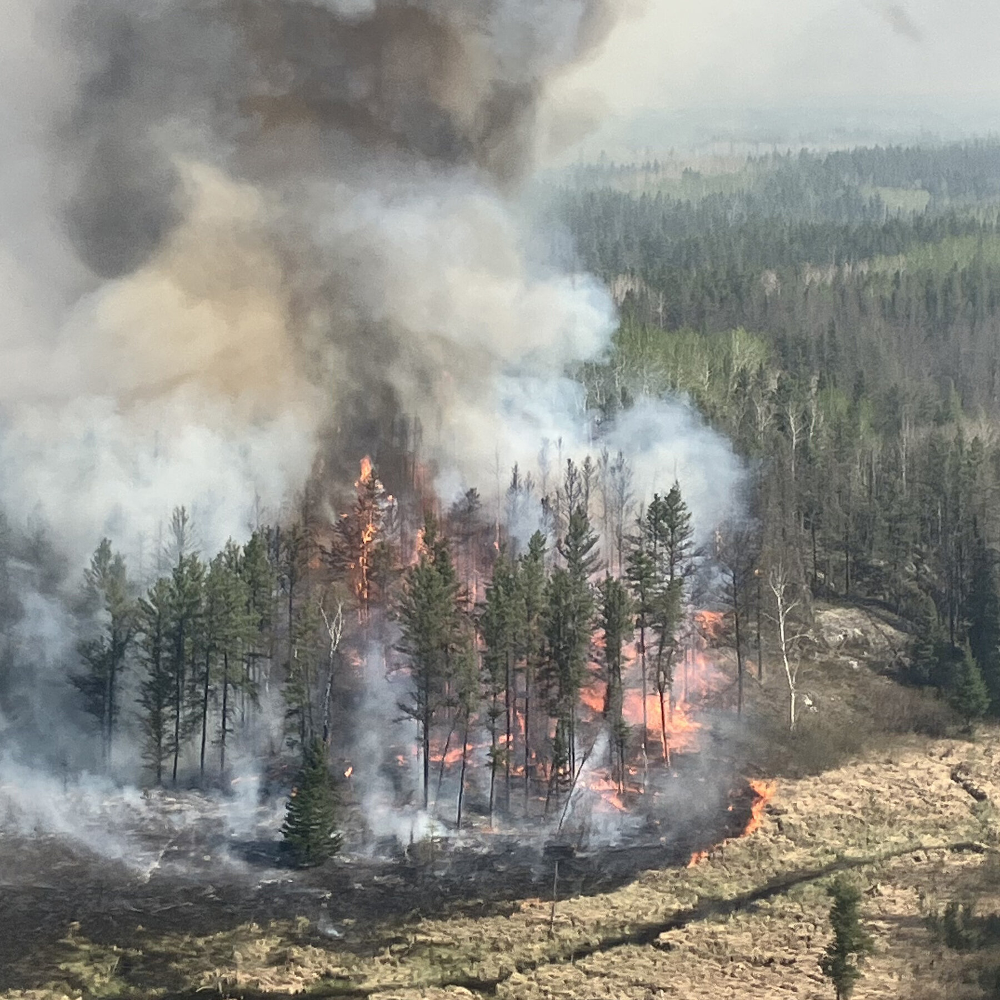
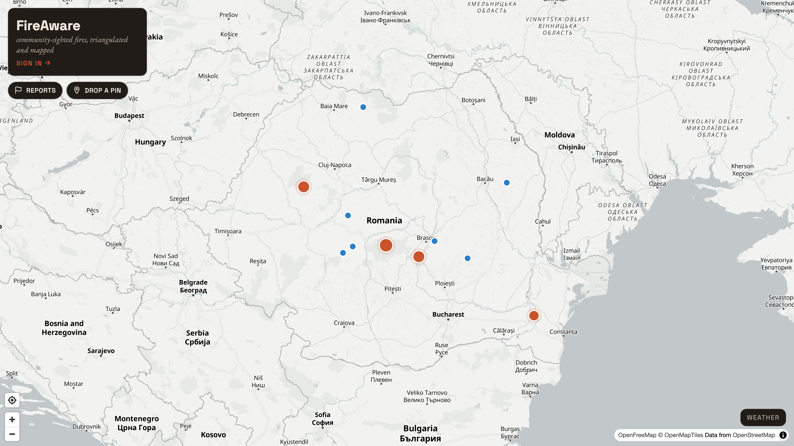
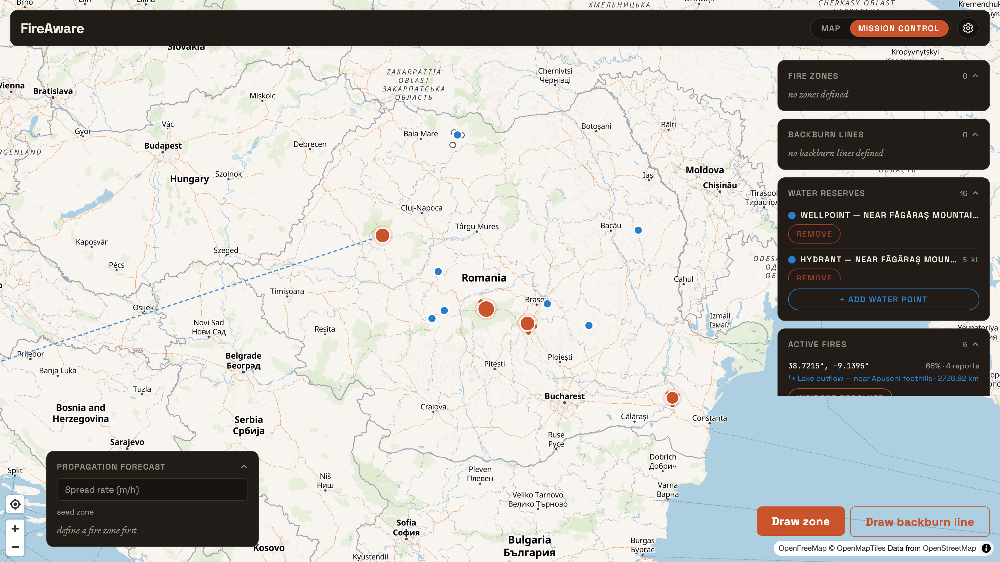
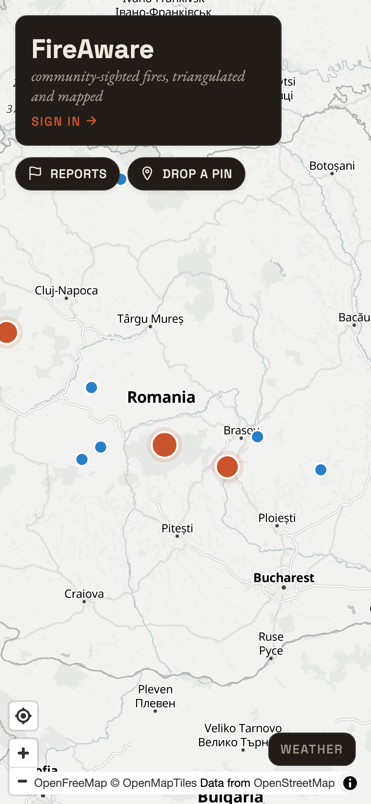

<div align="center">



# FireAware

**Catch wildfires in the first ten minutes — not from a satellite, from the people who can see them.**

Crowdsourced fire-spotting platform. Mobile users photograph distant fires; the backend triangulates bearings from multiple sightings and renders confirmed fires on a public map in near real-time.

<br />

[](#stack)
[](#stack)
[](#stack)
[](#stack)
[](#stack)
[](#license)

<sub>Single codebase · iOS · Android · Web · PWA-ready</sub>

</div>

---

## Table of contents

- [What it does](#what-it-does)
- [By the numbers](#by-the-numbers)
- [Screenshots](#screenshots)
- [Features](#features)
- [How it works](#how-it-works)
- [Architecture](#architecture)
- [Tech stack](#tech-stack)
- [Quick start](#quick-start)
- [API reference](#api-reference)
- [Roles & permissions](#roles--permissions)
- [Repo layout](#repo-layout)
- [Roadmap](#roadmap)
- [License](#license)

---

## What it does

Satellites spot wildfires once they're big enough to see from orbit. By then it's often too late. **FireAware shortens that gap to minutes** by turning every phone within sight of a column of smoke into a bearing-ray sensor.

- A hiker or farmer sees smoke on the horizon.
- They open FireAware, the app walks them through a quick GPS + compass calibration, and they snap one photo pointed at the smoke.
- The backend takes that `{photo, lat, lon, bearing, accuracy, timestamp}` tuple, cross-references every other recent report within a 50 km / ±2 h window, and solves for where the bearings intersect.
- Within seconds, a new pin lights up on the public map — and firemen with an elevated role can draw response zones, firebreaks, water-reserve pins and a time-stepped propagation forecast on top of it.

---

## By the numbers

<div align="center">

| | |
|:---:|:---:|
| **23** REST endpoints | **6** PostGIS models |
| **19** mobile screens | **15** shared components |
| **~1.8 k** LOC backend (Python) | **~6.7 k** LOC frontend (TS/TSX) |
| **50 km × 2 h** triangulation window | **≤ 20 m** GPS precision gate |
| **< 3°** required compass jitter | **200 m** DBSCAN cluster radius |
| **YOLOv11-s** fire / smoke model | **5 ×** response-time multipliers (1 h → 24 h) |

</div>

---

## Screenshots

> Drop PNGs into `docs/screenshots/` with the filenames below and they'll light up here. Hero fire photo above is one of the training-set frames.

<div align="center">

### Public map · web



<sub>Confirmed fires, raw sightings toggle, weather widget, click-to-report pin-drop demo.</sub>

<br /><br />

### Mission control · fireman role



<sub>Draw response zones, firebreak cutting lines, place water-reserve pins, and step a propagation forecast forward in 1 / 2 / 4 / 8 / 24 h rings driven by live wind data.</sub>

</div>

<br />

<table width="100%">
<tr>
<td align="center" width="25%">
<br />
<sub><b>Mobile map</b></sub>
</td>
<td align="center" width="25%">
<br />
<sub><b>Calibration gate</b></sub>
</td>
<td align="center" width="25%">
<br />
<sub><b>Camera capture</b></sub>
</td>
<td align="center" width="25%">
<br />
<sub><b>Confirm & submit</b></sub>
</td>
</tr>
</table>

---

## Features

### For everyone

- **Public live map** — no account required. MapLibre GL, hardware-accelerated vector tiles, raw sightings overlay, weather widget, click-to-pin-drop demo on web.
- **One-tap report flow** — camera, GPS and compass are gated so bad data never reaches the backend.
- **Fire detail pages** — every confirmed fire exposes contributing photos, confidence score, bearing geometry and the reporters' obscured positions.

### For reporters

- **GPS precision gate** — report flow blocks until horizontal accuracy ≤ 20 m.
- **Compass calibration** — rejects the shutter until bearing jitter is under 3° for 2 s.
- **Atomic capture** — photo, lat, lon, bearing, both accuracies and timestamp are bundled in a single multipart request.
- **YOLO v11 pre-check** — the backend's `ultralytics` model runs over the uploaded frame and surfaces its fire / smoke detections on the confirm screen before the report is committed.
- **"My reports"** — see which of your sightings fed which confirmed fire.

### For firemen (elevated role)

Firemen are provisioned by environment variable at boot (`FIREMAN_EMAIL_*`) — the only path that grants the role. They unlock a full **Mission Control** sidebar:

- **Fire zones** — draw arbitrary polygons on the map, colour-code, label, auto-compute area.
- **Cutting lines (firebreaks)** — polylines with a configurable protective range buffer and length readout.
- **Water reserves** — point markers with name + capacity for logistics planning.
- **Propagation forecast** — pick a zone and a propagation rate, backend shells the polygon outward through 1 h, 2 h, 4 h, 8 h and 24 h rings using **live wind direction** from Open-Meteo to bias the growth.
- **Backburn corridor** — pair a zone with a cutting line and the map renders the controlled-burn corridor between them.
- **Resolve incidents** — confirmed fires can be marked resolved from the sidebar once ground truth is in.

### Under the hood

- **Bearing-ray triangulation** — pairwise great-circle intersections, each validated against both bearings' uncertainty wedges.
- **DBSCAN clustering** (`eps = 200 m`, `minPts = 2`) over the intersection cloud — each cluster becomes one `Fire` row.
- **Confidence score** = f(contributing report count, cluster tightness, bearing uncertainty).
- **PostGIS everywhere** — `geography(POINT, 4326)` for reports and reserves, `geography(POLYGON, 4326)` for zones, `geography(LINESTRING, 4326)` for firebreaks. Every spatial query goes through a GiST index.
- **MinIO photo store** proxied through the backend so phones on the LAN never need to know the storage host.
- **JWT access + refresh pair**, bcrypt hashes, `require_fireman` dependency guards every elevated-role endpoint.

---

## How it works

```
┌──────────────┐    photo + {lat,lon,bearing,acc,ts}     ┌────────────────┐
│   Mobile     │ ───────────────────────────────────────▶│   FastAPI      │
│   (Expo)     │                                         │   /reports     │
└──────────────┘                                         └────────┬───────┘
                                                                  │
                                                                  ▼
                                                   ┌────────────────────────────┐
                                                   │  recompute_for_region()    │
                                                   │  ─ pull reports ≤ 50 km,   │
                                                   │    ≤ 2 h old               │
                                                   │  ─ pairwise bearing-ray    │
                                                   │    great-circle intersect  │
                                                   │  ─ reject wedge misses     │
                                                   │  ─ DBSCAN cluster          │
                                                   │  ─ upsert Fire rows        │
                                                   └────────────┬───────────────┘
                                                                │
                                      ┌─────────────────────────┴──────────────────────────┐
                                      ▼                                                    ▼
                           ┌────────────────┐                                   ┌────────────────────┐
                           │   PostGIS      │                                   │   MinIO / S3       │
                           │   (fires,      │                                   │   (report photos)  │
                           │    reports,    │                                   └────────────────────┘
                           │    zones,      │
                           │    lines,      │
                           │    water)      │
                           └────────┬───────┘
                                    │
                                    ▼
                           ┌────────────────┐    live map + mission control    ┌─────────────────────┐
                           │   /fires       │ ◀───────────────────────────────▶│   Web / iOS /       │
                           │   GET, bbox    │                                  │   Android (MapLibre)│
                           └────────────────┘                                  └─────────────────────┘
```

1. **Mobile user** opens the report flow → app gates them through GPS precision check (≤ 20 m) and compass calibration (jitter < 3°).
2. At shutter press, the app captures `{photo, lat, lon, bearing, gps_acc, bearing_acc, timestamp}` atomically.
3. **Backend** receives the report, uploads the photo to S3/MinIO, and runs `recompute_for_region`:
   - Pulls recent reports within 50 km and ±2 h.
   - Computes pairwise great-circle bearing-ray intersections.
   - Validates each intersection falls inside both bearings' uncertainty wedges.
   - DBSCAN-clusters the intersection points (eps = 200 m, minPts = 2).
   - Each cluster becomes one `Fire` row with confidence proportional to report count and cluster tightness.
4. **Web + mobile visitors** see `Fire` markers on a MapLibre map at `/`. No login required.
5. **Firemen** can draw response zones / cutting lines / water pins and project propagation forward from any zone, biased by live Open-Meteo wind.

See [DESIGN.md](DESIGN.md) for the full architecture, data model and triangulation algorithm notes.

---

## Architecture

```
app/                                   backend/
├── (map)/        public map + mission ├── api/v1/      23 REST endpoints
├── (app)/        authenticated shell  ├── services/
│   └── report/   calibrate → capture  │   ├── triangulation.py   bearing-ray + DBSCAN
│       → confirm                      │   ├── vision.py          YOLO v11 lazy loader
├── (auth)/       login / register     │   ├── storage.py         S3 / MinIO wrapper
├── fire/[id]/    fire detail          │   ├── synth.py           synthetic report generator
├── components/map                     │   └── fireman_seed.py    env-driven role grant
│   ├── MapShell.tsx (shared canvas)   ├── models/                6 PostGIS models
│   ├── MissionControlOverlays.tsx     ├── schemas/               pydantic I/O contracts
│   └── types.ts (geo helpers)         └── alembic/               migrations
└── lib/api.ts    typed API client
```

---

## Tech stack

<table>
<tr>
<td valign="top" width="50%">

### Backend

- **FastAPI** 0.115 (Python 3.12)
- **PostgreSQL 16 + PostGIS 3.4**
- **SQLAlchemy 2 + GeoAlchemy2**
- **Alembic** migrations
- **JWT** access / refresh (python-jose, bcrypt)
- **MinIO / S3** photo store (boto3)
- **Ultralytics YOLO v11** fire / smoke detection
- **scikit-learn** DBSCAN clustering
- **shapely + numpy** bearing-ray geometry
- **Open-Meteo** wind forecast (httpx)

</td>
<td valign="top" width="50%">

### Frontend

- **Expo SDK 54** · single codebase, 3 targets
- **expo-router 6** file-based routing
- **React 19 + React Native 0.81**
- **MapLibre GL** (web) + **react-native-maps** (native)
- **expo-camera**, **expo-sensors**, **expo-location**
- **@tanstack/react-query** data layer
- **zustand** UI state
- **expo-secure-store** token vault
- **@expo-google-fonts** · EB Garamond + Space Grotesk + JetBrains Mono
- **EAS Build** for native binaries

</td>
</tr>
</table>

---

## Quick start

```bash
# 1. Start postgres+postgis and minio
docker compose up -d

# 2. Backend
cd backend
python -m venv .venv && source .venv/bin/activate
pip install -e ".[dev]"
cp .env.example .env
alembic upgrade head
python scripts/seed.py            # creates demo user + 4 reports → 1 triangulated fire
uvicorn app.main:app --reload     # http://localhost:8000
```

**Demo account:** `demo@fireaware.dev` / `demo-password-123`

```bash
# 3. Frontend (in another terminal)
cd app
npm install
npx expo start                    # press w / i / a
```

**Grant the fireman role** by adding `FIREMAN_EMAIL_1=you@example.com` (and `_2`, `_3`, …) to `backend/.env` — the app syncs these on boot. There's no in-app path to escalate.

**Optional model weights** live in `trainDataset/best.pt` — point `MODEL_WEIGHTS_PATH` at it (or any YOLO v11 checkpoint) to enable the vision pre-check on upload.

---

## API reference

<div align="center">

| Method | Path | Auth | Purpose |
|:---:|---|:---:|---|
| `GET` | `/health` | — | Liveness probe |
| `POST` | `/api/v1/auth/register` | — | Create account, returns token pair |
| `POST` | `/api/v1/auth/login` | — | Password → token pair |
| `POST` | `/api/v1/auth/refresh` | — | Refresh access token |
| `GET` | `/api/v1/users/me` | user | Current user |
| `GET` | `/api/v1/fires` | — | List active fires (optional bbox) |
| `GET` | `/api/v1/fires/{id}` | — | Fire detail + contributing photos |
| `DELETE` | `/api/v1/fires/{id}` | fireman | Resolve a confirmed fire |
| `GET` | `/api/v1/reports` | — | Raw sightings (public overlay) |
| `GET` | `/api/v1/reports/mine` | user | User's own reports |
| `POST` | `/api/v1/reports` | user | Submit sighting (multipart) |
| `POST` | `/api/v1/reports/analyze` | user | Run YOLO on a photo without committing |
| `POST` | `/api/v1/reports/demo` | user | Seed a synthetic sighting (dev-only) |
| `GET` | `/api/v1/photos/{key}` | — | Proxy a photo from MinIO |
| `GET` | `/api/v1/weather` | — | Open-Meteo wind + temp for a lat/lon |
| `GET` | `/api/v1/fire-zones` | — | List fireman-drawn zones |
| `POST` | `/api/v1/fire-zones` | fireman | Create a polygonal response zone |
| `DELETE` | `/api/v1/fire-zones/{id}` | fireman | Delete a zone |
| `GET` | `/api/v1/cutting-lines` | — | List firebreak polylines |
| `POST` | `/api/v1/cutting-lines` | fireman | Draw a firebreak with range buffer |
| `DELETE` | `/api/v1/cutting-lines/{id}` | fireman | Delete a firebreak |
| `GET` | `/api/v1/water-reserves` | — | List water points |
| `POST` | `/api/v1/water-reserves` | fireman | Add a water-reserve pin |
| `DELETE` | `/api/v1/water-reserves/{id}` | fireman | Delete a water pin |

</div>

Interactive OpenAPI docs: `http://localhost:8000/docs` when the backend is running.

---

## Roles & permissions

| Capability | anonymous | user | fireman |
|---|:---:|:---:|:---:|
| View public map, fires, raw sightings | ● | ● | ● |
| Fetch weather, photos, zones, lines, water | ● | ● | ● |
| Submit a sighting | | ● | ● |
| See "My reports" | | ● | ● |
| Pre-analyze a photo (YOLO) | | ● | ● |
| Draw fire zones / cutting lines / water pins | | | ● |
| Project propagation forecast | | | ● |
| Mark incidents resolved | | | ● |

Roles are provisioned out-of-band via `FIREMAN_EMAIL_N` env vars — there's no HTTP endpoint that grants `fireman`, so a stolen user token can't escalate.

---

## Repo layout

```
fireaware/
├── backend/              FastAPI app, Alembic migrations, triangulation + vision services
│   ├── app/
│   │   ├── api/v1/       23 endpoints across 10 modules
│   │   ├── models/       6 PostGIS SQLAlchemy models
│   │   ├── schemas/      pydantic request / response contracts
│   │   ├── services/     triangulation, vision (YOLO), storage, synth, fireman seed
│   │   └── core/         config, db session, security helpers
│   ├── alembic/          migration chain
│   ├── scripts/          seed.py, seed_romania.py, demo_new_fire.py
│   └── pyproject.toml
│
├── app/                  Expo single-codebase frontend (web + iOS + Android)
│   ├── app/              expo-router routes
│   │   ├── (map)/        public map + mission control
│   │   ├── (app)/        authenticated shell (report flow, profile, settings)
│   │   ├── (auth)/       login + register
│   │   └── fire/[id]/    fire detail
│   ├── components/       MapShell, LoginIsland, UI primitives, map overlays
│   ├── lib/              typed API client, auth store, hooks
│   ├── theme/            tokens for light + dark
│   ├── assets/           icons, splash, fonts
│   └── eas.json          EAS Build config
│
├── trainDataset/         YOLO v11 training script + released checkpoints (best.pt)
├── docs/screenshots/     drop PNGs here to populate the README gallery
├── docker-compose.yml    PostgreSQL + PostGIS + MinIO
├── image.png             hero fire photo (training set)
└── DESIGN.md             full architecture + algorithm notes
```

---

## Roadmap

- **Push notifications** when a new fire pin lights up within a saved radius.
- **Satellite cross-check** — FIRMS / MODIS overlays as a confidence multiplier.
- **Offline-first report queue** — hold sightings on-device if the hiker is out of signal, flush on reconnect.
- **Wind-biased propagation v2** — replace the uniform shell with a slope + fuel-type aware model.
- **Multilingual UX** — RO / EN / FR / ES at a minimum.
- **Playable demo map** on `fireaware.dev` seeded with historical Romania fire data.

---

## License

MIT. See `LICENSE`.

<div align="center">
<sub>Built with FastAPI, PostGIS, Expo, MapLibre and a lot of smoke detection.</sub>
</div>
